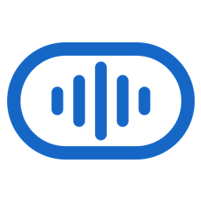

<p align="right">
  <a href="README.md" title="切换到 English">
    
  </a>
</p>

<p align="center">
  
</p>

<h1 align="center">KeepQuiet</h1>

<p align="center">
  <b>面向 Windows 游戏和通话的本地实时人声分离与降噪工具</b><br>
  <sub>Local Real-Time Voice Isolation &amp; Noise Suppression for Windows Games and Calls</sub>
</p>

<p align="center">
  
  
  
  
  
</p>

<p align="center"></p>

---

## 概述

**KeepQuiet** 是一款适用于 Windows 10/11 x64 的离线实时人声分离与降噪桌面工具。它通过固定串联的两级神经网络模型，在本地 CPU 上处理麦克风音频，再将处理后的语音送入虚拟音频线缆，供游戏、语音聊天和通话软件使用：

```text
麦克风（WASAPI）
    ↓
Alkove Focus — 近场人声分离
    ↓
Denoiser DNS48 — 噪声抑制
    ↓
VB-CABLE → 游戏或通话软件
```

Alkove Focus 优先保留最靠近麦克风的近场人声，抑制距离较远的背景人声，再由 Denoiser DNS48 进一步降低环境噪声。这种方式依据声源的远近特征分离人声，不通过声纹录入锁定指定的人；实际效果受麦克风摆放、房间声学环境及现场人声情况影响。

所有推理均 **100% 在本地离线运行**。KeepQuiet 不会将麦克风音频保存到磁盘，也不会上传音频。独立运行包内置 Python、CPU 推理依赖、Focus/Cue/DNS48 权重以及 VB-CABLE 原始安装包，无需单独下载 Python、CUDA 或驱动包。

---

## 主要功能

- **固定串联的双模型处理链路**：先运行 Alkove Focus，再运行 Denoiser DNS48。内部采用 16 kHz 单声道音频，每块 256 个采样。两个处理阶段均启用，不混合原声与处理后声音，也不会在出错时悄悄回退到原始麦克风音频。
- **Windows 原生 WASAPI 音频**：直接使用事件驱动的 WASAPI 采集和播放，不依赖外部音频或界面框架。界面小巧且尺寸固定，提供平滑的输入、输出电平显示和独立的本地耳机监听。
- **麦克风确认与静音启动自检**：每次主界面启动前，都会让用户选择或确认麦克风，并提醒确保设备已开启且未静音。点击 **Run test（开始自检）** 后，以静音输出测试经过两个模型与 VB-CABLE 的真实音频流。已选设备不可用时，不会自动替换为其他麦克风。
- **智能 VB-CABLE 检测与修复**：根据内置 INF 中指定的硬件 ID 和服务，通过 Windows 端点拓扑核验 VB-CABLE 的身份。检测到驱动缺失或安装不完整时，请求管理员授权以运行内置安装程序，并保存等待初始化或需要重启的状态，避免重复安装。
- **诊断与故障恢复**：启动阶段遇到短暂卡顿时，提供一次有限的恢复观察；隔离无关音频设备的查询错误，并提供英文与简体中文故障处理建议。错误提示支持点击打开诊断日志文件夹，日志位于 **%LOCALAPPDATA%/KeepQuiet/logs**。
- **双语界面与托盘运行**：支持即时切换 **English/简体中文**，语言选择在下次启动时保留。提供单实例保护和后台托盘运行，左键恢复窗口，右键单击并选择“退出”以关闭程序。

---

## 下载与快速开始

从仓库的 **[Releases](../../releases)** 页面下载 **KeepQuiet-0.3.0-win-x64.zip**，完整解压后运行 **KeepQuiet.exe**。需要 **Windows 10/11 x64** 和 **.NET Framework 4.8**。

1. **确认并测试麦克风**：启动时选择麦克风，确保设备已经开启且未静音，然后点击 **Run test（开始自检）**。通过后，在主界面保持 **CABLE Input** 为虚拟输出设备。
2. **启动处理**：点击 **Start（启动）**，然后在游戏或通话软件中，将麦克风设置为 **CABLE Output**。
3. **本地监听，可选**：选择耳机，并在降噪处理开始后开启 **Monitor（监听）**，即可听到处理后的语音。

---

## 从源码构建

需要 **Windows x64 版 CPython 3.12.10** 和 **.NET Framework 4.8**，并确保 **python** 命令指向该 Python 安装。从仓库根目录使用 Windows PowerShell 运行以下命令。首次配置及独立运行包构建需要联网下载依赖和模型，推理过程离线运行。无需安装 Visual Studio、.NET SDK、NuGet 或 Node.js。

```powershell
powershell -NoProfile -ExecutionPolicy Bypass -File ./setup-models.ps1
powershell -NoProfile -ExecutionPolicy Bypass -File ./build.ps1 -Test
./dist/KeepQuiet.Tests.exe --ui ./artifacts/ui
./dist/KeepQuiet.Tests.exe --startup-ui ./artifacts/startup-ui
powershell -NoProfile -ExecutionPolicy Bypass -File ./build-portable.ps1
```


---

## 许可与第三方组件

- KeepQuiet 的自研代码、项目文档及图标采用 **[CC BY-NC 4.0](LICENSE)** 许可。详见 [NOTICE](NOTICE) 和[许可范围](LICENSING.md)。
- 第三方组件保留各自的许可条款，其中 Denoiser 采用 CC BY-NC 4.0。详见 [THIRD-PARTY.md](THIRD-PARTY.md)。
- VB-CABLE 是 [VB-Audio](https://www.vb-cable.com/) 提供的 Donationware，欢迎[支持原作者](https://shop.vb-audio.com/en/win-apps/11-vb-cable.html)。
